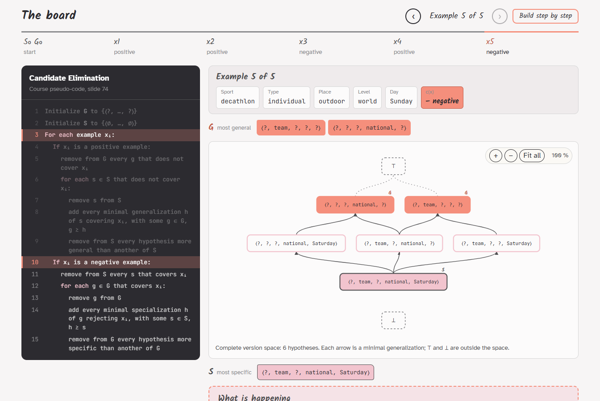
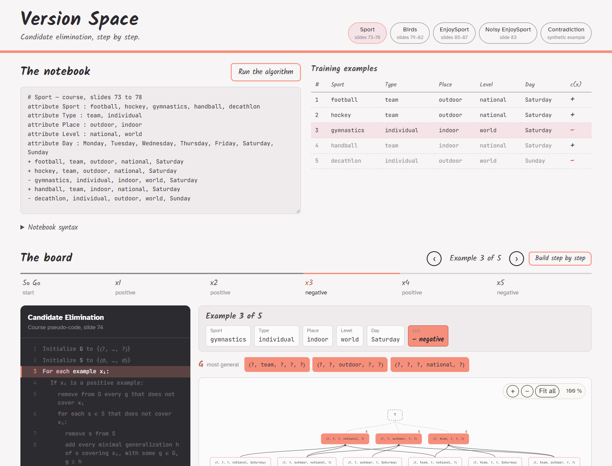

# Version Space — candidate elimination, step by step

Educational web application for the **candidate elimination** algorithm (Mitchell, 1977), built on the
examples of the course *Machine Learning Theory*, chapter 2 (slides 72 to 87).



## Demo video

[](docs/demo.mp4)

▶ [Watch the demo (1 min 40, voice-over and subtitles)](docs/demo.mp4): the notebook, the board with the pseudo-code, step-by-step build, zoom, infinite and collapsing spaces, and instance classification.

## What the application does

- **The notebook**: you describe the dataset in a small text format. Errors are reported with their
  line number, and the faulty line is selected.
- **The board**: you move through the examples one at a time, with the arrows, the timeline, or by
  clicking “Build step by step”, which plays the whole dataset with a comment at each step.
  - The course pseudo-code (slide 74) is shown next to the drawing, with the lines executed at the
    current step highlighted.
  - The current example, G, S and the drawing of the version space are visible together.
  - The log lists the operations of the example: removal, generalization, specialization, rejection
    by the other boundary, pruning.
- **The drawing** is computed from S and G:
  - if the version space has at most 60 hypotheses, it is drawn in full with its covering edges
    (minimal generalizations);
  - otherwise only the boundaries appear, joined by dotted lines; this is the case of Birds, whose
    space is infinite.
  - The drawing zooms with the mouse wheel (towards the cursor) or with the + / − buttons, pans by
    dragging, and “Fit all” (or a double-click) goes back to the full view.
  - Clicking a hypothesis highlights the paths towards more general and more specific hypotheses.
- **Classifying** a new instance gives four possible verdicts:
  - positive beyond doubt, if every element of S covers it;
  - negative beyond doubt, if no element of G covers it;
  - undetermined, in the other cases;
  - no hypothesis, if the version space is empty.

  The detail is given constraint by constraint, with the exact count of hypotheses voting yes and no
  (a count, not a probability).
- **Exports**: Markdown report and JSON results.

Palette: charcoal `#2C2B30`, grey `#4F4F51`, light grey `#D6D6D6`, pink `#F2C4CE` and coral `#F58F7C`
(G in solid coral, S in pink with a grey outline; a darkened coral `#C25B47` is used for text and
errors to stay readable).

Included datasets: Sport (slides 73–78), Birds with intervals and a colour hierarchy (slides 79–82),
EnjoySport (slides 85–87), noisy EnjoySport (slide 83) and a contradictory example.

## Architecture

```
api/                 Python serverless functions (Vercel), standard library only
  _ce.py             the engine: attributes, generality order, algorithm, version space
  _carnet.py         notebook format parsing and construction of the JSON responses
  _exemples.py       course datasets
  _http.py           shared request handling
  executer.py        POST /api/executer  { texte }                 → S/G states, log, graph
  classer.py         POST /api/classer   { texte, valeurs, etape } → verdict
  exemples.py        GET  /api/exemples
public/              static interface, plain JavaScript, no framework and no build step
  index.html  style.css  app.js  graphe.js
serveur.py           local development server (same routing as Vercel)
tests/               Python unit tests + browser walkthrough (Playwright)
```

All the computation is done on the server; the browser only displays the states it receives.

### Hypothesis language

- **Categorical attribute**: a constraint is the set of accepted values. The language contains
  `?` (the whole domain), each single value and, if declared, each group of a tree hierarchy
  (for example `warm colour = {russet, orange}`). The smallest generalization is the smallest
  node containing both sets. The minimal specializations are the maximal strictly included nodes
  that reject the value.
- **Numeric attribute**: a constraint is a closed interval `[low, high]` on the grid
  `min + k·step`. The domain can be unbounded (`interval 0 .. inf step 1`). Generalizing widens
  the interval up to the value. Specializing cuts around the value: `[low, v − step]` and
  `[v + step, high]`. This gives `[0, 69]` and `[71, +∞[` from slide 80.
- **Missing value**: written `?` in an example. Only the `?` constraint accepts it.

## Notebook format

```
# Birds
attribute Flat bill : True, False
attribute Size : interval 0 .. inf step 1
attribute Neck colour : russet, orange, grey
  group warm colour : russet, orange
  group cold colour : grey
+ True, 30, russet
- False, 70, grey
```

The French keywords (`attribut`, `groupe`, `intervalle`, `pas`) are still accepted as aliases.

## Run locally

Python 3.10 or newer is required. There is nothing to install.

```bash
python serveur.py            # http://localhost:8000
```

## Tests

```bash
python -m unittest discover -s tests -v
```

The tests cover:

- every step of Sport, Birds, EnjoySport and noisy EnjoySport;
- the size of H (1297, slide 78) and the final 6-hypothesis space with its 7 edges;
- the 3/3 and 2/4 votes of slide 87;
- a **brute-force check** on 250 random datasets: all of H is enumerated, the consistent
  hypotheses are kept, their minimal and maximal elements are taken, and compared with S and G;
- the notebook format errors and the HTTP API, called for real.

Browser walkthrough, with the server running:

```bash
npm install --no-save playwright && npx playwright install chromium
node tests/parcours_navigateur.cjs
```

## Deploy on Vercel

1. Push the repository to GitHub.
2. On Vercel, choose *Add New → Project* and import the repository. The *Framework Preset* is
   **Other**; there is no build command and no environment variable.
3. Deploy. Vercel serves `public/` statically and turns `api/*.py` into Python functions. Files
   starting with `_` are shared modules, not routes.

## References

- N. Ben Amor, *Machine Learning Theory*, chapter 2.
- T. M. Mitchell, *Machine Learning*, McGraw-Hill, 1997, chapter 2.
